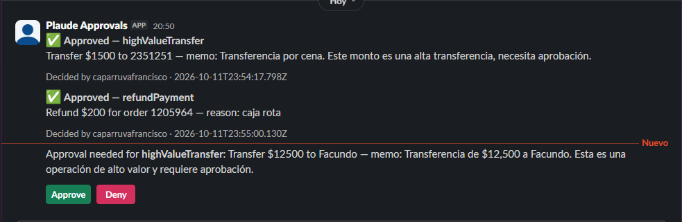
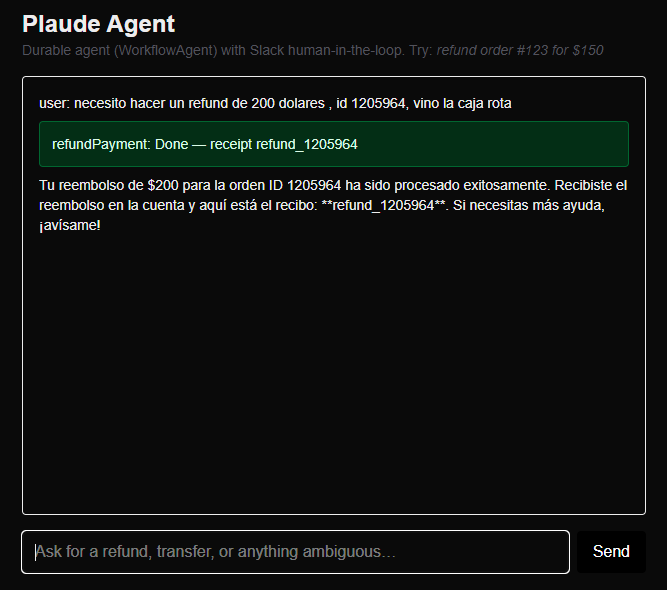
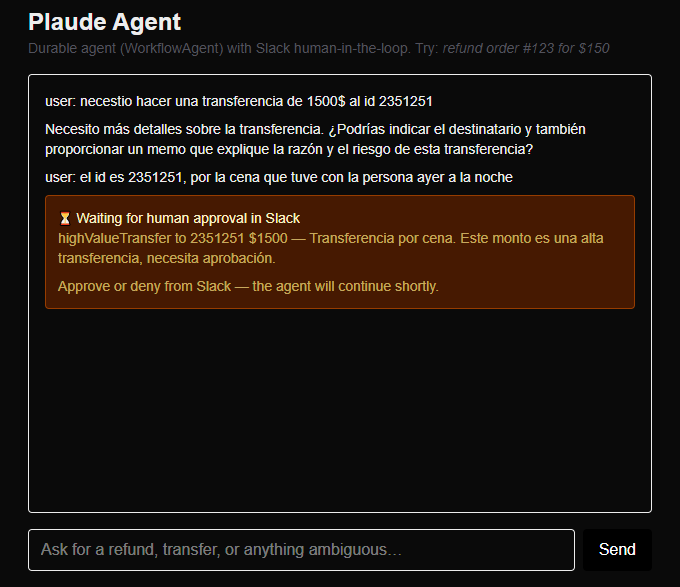
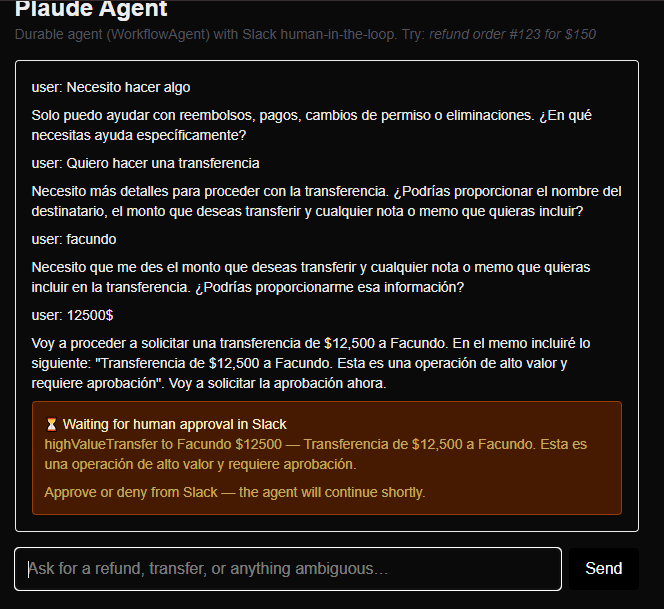
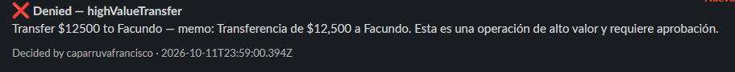
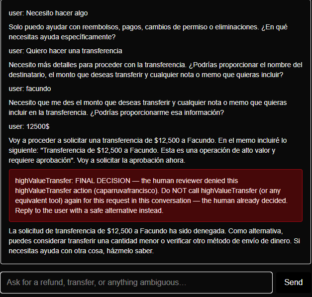

# Plaude Engineering Challenge

[https://plaude.com/api/challenge](https://plaude.com/api/challenge)

AI agent powered by plain-text instructions with a Slack human-in-the-loop workflow.

## Stack

- Next.js (Chat) + TypeScript
- Workflow DevKit (`workflow@5`) + `WorkflowAgent` (`@ai-sdk/workflow`, successor of the deprecated `DurableAgent`)
- Vercel AI Gateway for models
- Slack Web API (outgoing: we post Block Kit Approve/Deny cards via `chat.postMessage` / `chat.update`)
- Slack interactivity webhook (incoming: Slack delivers button clicks as `block_actions` payloads to our endpoint, signature-verified)

## Setup

```bash
pnpm install
cp .env.example .env.local  # fill in keys
pnpm run dev
```

## Scripts

- `npm run dev` — dev server
- `npm run build` — production build
- `npm run test` — unit tests (vitest)
- `npm run lint` — eslint

## Structure

- `app/page.tsx` — chat UI (`useChat` + `WorkflowChatTransport`)
- `app/api/chat/route.ts` — starts the durable workflow
- `workflow/agent-chat.ts` — `"use workflow"` agent loop
- `lib/agent.ts` — plain-text approval instructions (refunds, high-value, ambiguous)
- `lib/policy.ts` — testable approval policy mirroring the instructions
- `lib/tools.ts` — durable `"use step"` tool executors + `needsApproval` gates
- `lib/slack.ts` — Slack approval messages (mock fallback without a token)

## How it works

1. The user asks for a refund, transfer, or an ambiguous operation in the chat.
2. The `WorkflowAgent` (`workflow/agent-chat.ts`) calls the matching tool (`refundPayment` / `highValueTransfer` in `lib/tools.ts`).
3. If human approval is needed, the tool posts an Approve/Deny card to Slack (`lib/slack.ts`) and suspends the workflow on a hook tokened by the `toolCallId` (`workflow/hooks/approval.ts`).
4. A human decides **only in Slack** — Slack sends the button click to our endpoint as a `block_actions` webhook (`app/api/slack/interactivity/route.ts`), which verifies the signature and resumes the suspended hook. The chat card is read-only status.
5. The workflow resumes: on approval it executes the simulated payout and returns a receipt; on denial it returns a final decision and the agent proposes a safe alternative without retrying.

## Cases

### 1. Refund requiring approval → approved

A $200 refund pauses for human review. Slack shows the `refundPayment` card approved by the reviewer, and the chat completes with the receipt:





### 2. High-value transfer → approval pending

Transfers always require approval. The chat waits read-only while the decision happens in Slack:



### 3. Ambiguous request → clarifying questions

When recipient, amount, or intent is missing, the agent asks for details instead of making the wrong decision. Once complete, it requests approval in Slack:



### 4. Denied request → safe alternative

When the reviewer denies in Slack, the chat shows the final decision and the agent proposes a safe alternative instead of retrying:





